# BÁO CÁO TIẾN ĐỘ THỰC TẬP CHUYÊN NGÀNH - TUẦN 6

- **Đề tài:** Website quản lý trung tâm bóng rổ (3 phân hệ: Admin, Huấn luyện viên, Phụ huynh)
- **Sinh viên thực hiện:** Nguyễn Ngô Khánh Duy
- **Thời gian báo cáo:** Tuần 6 (Cập nhật đến ngày 18/11/2026)
- **Kho lưu trữ mã nguồn:** https://github.com/nguyenngokhanhduy2004nvt-2711/QuanLyTrungTamBongRo
---

## 1. Công việc đã thực hiện trong tuần 6
- **Khởi tạo dự án:** Tạo solution **ASP.NET Core MVC** trên Visual Studio 2022; tổ chức Controller và View riêng cho từng phân hệ (`Admin`, `Coach`, `PhuHuynh`) và phần đăng nhập (`DangNhap`); bật Session phục vụ đăng nhập.
- **Thiết kế giao diện:** Thiết kế mockup giao diện cho cả 3 phân hệ: trang tổng quan Admin (số liệu, biểu đồ doanh thu, việc chờ xử lý), trang điểm danh của HLV, trang chủ phụ huynh (lịch học, chuyên cần, học phí). Thống nhất phong cách thể thao (màu cam và xanh đen).
- **Giao diện đăng nhập:** Hoàn thành giao diện trang đăng nhập cho 3 vai trò và đưa vào mã nguồn (`src/NguyenNgoKhanhDuy-DH52200571/Views/DangNhap/Login.cshtml`).
- **Thiết kế cơ sở dữ liệu:** Xây dựng 17 thực thể theo mục dữ liệu của đặc tả (người dùng, HLV, phụ huynh, học viên, khóa học, sân, lớp, đăng ký lớp, ca học, điểm danh, học phí, hóa đơn, bảng lương, giáo án, thông báo, góp ý, nhật ký) và vẽ **sơ đồ ERD** lưu tại `docs/thiet_ke.md`. Thiết lập khung Entity Framework Core (`Migrations`, lớp người dùng).
- **Chuẩn bị đăng nhập và phân quyền (`FR-01`):** Viết mã băm mật khẩu một chiều, khóa tạm khi đăng nhập sai nhiều lần, chặn truy cập trái vai trò ở phía máy chủ và đăng ký tài khoản phụ huynh chờ Admin duyệt; đang tích hợp vào dự án để kiểm thử.
- **Dữ liệu giả lập:** Soạn script nạp dữ liệu mẫu (3 HLV, 5 lớp, 40 học viên, 2 sân, ca học và điểm danh mẫu), đang kiểm chứng.
- **Đưa mã nguồn lên GitHub:** Đưa dự án ASP.NET Core MVC vào thư mục `src/` của kho lưu trữ để giảng viên theo dõi.
- **Công cụ hỗ trợ:** Em có sử dụng trợ lý AI Claude (Anthropic) để hỗ trợ thiết kế mockup và soạn mã mẫu cho phần cơ sở dữ liệu và đăng nhập; em chịu trách nhiệm đọc hiểu, chỉnh sửa và kiểm thử toàn bộ mã đưa vào dự án.

### Sơ đồ tiến độ tuần 6

Xanh lá là hoàn thành, vàng là đang làm, xám là chưa làm.

```mermaid
flowchart TD
    W6(["Tuần 6 - Công việc và tiến độ"])

    W6 --> P1["Dự án và kiến trúc"]
    W6 --> P2["Giao diện"]
    W6 --> P3["Cơ sở dữ liệu"]
    W6 --> P4["Đăng nhập và phân quyền FR-01"]
    W6 --> P5["Tài liệu và kho mã nguồn"]

    P1 --> P1a["Khởi tạo dự án ASP.NET Core MVC trên Visual Studio 2022"]
    P1 --> P1b["Controller và View cho Admin, Coach, PhuHuynh, DangNhap"]
    P1 --> P1c["Bật Session cho đăng nhập"]

    P2 --> P2a["Mockup giao diện 3 phân hệ Admin, HLV, Phụ huynh"]
    P2 --> P2b["Mockup trang đăng nhập"]
    P2 --> P2c["Giao diện đăng nhập trong mã nguồn"]
    P2 --> P2d["Đưa giao diện 3 phân hệ vào View"]

    P3 --> P3a["Khung Entity Framework Core Migrations, lớp User"]
    P3 --> P3b["Thiết kế 17 thực thể theo đặc tả"]
    P3 --> P3c["Sơ đồ ERD"]
    P3 --> P3d["Dữ liệu giả lập 3 HLV, 5 lớp, 40 học viên, 2 sân"]

    P4 --> P4a["Băm mật khẩu, khóa tạm khi sai nhiều lần"]
    P4 --> P4b["Chặn truy cập trái vai trò"]
    P4 --> P4c["Đăng ký phụ huynh, chờ Admin duyệt"]
    P4 --> P4d["Kiểm thử và lưu bằng chứng FR-01"]

    P5 --> P5a["Đưa mã nguồn lên GitHub, thư mục src"]
    P5 --> P5b["Tài liệu thiết kế docs/thiet_ke.md"]
    P5 --> P5c["Bảng truy vết docs/truy_vet.csv"]

    classDef done fill:#DCFCE7,stroke:#15803D,color:#14532D
    classDef doing fill:#FEF3C7,stroke:#B45309,color:#78350F
    classDef todo fill:#F1F5F9,stroke:#64748B,color:#334155
    classDef root fill:#0F172A,stroke:#0F172A,color:#FFFFFF
    classDef grp fill:#FFEDD5,stroke:#C2410C,color:#7C2D12

    class W6 root
    class P1,P2,P3,P4,P5 grp
    class P1a,P1b,P1c,P2a,P2b,P2c,P3a,P3b,P3c,P5a,P5b,P5c done
    class P2d,P3d,P4a,P4b,P4c doing
    class P4d todo
```

---

## 2. Trạng thái các yêu cầu chức năng (Theo `truy_vet.csv`)

| Mã yêu cầu | Mức độ | Nội dung chức năng | Trạng thái | Ghi chú |
| :--- | :--- | :--- | :--- | :--- |
| **FR-01** | Bắt buộc | Đăng nhập và phân quyền 3 vai trò (Admin, HLV, Phụ huynh) | Đang làm | Giao diện xong; đang tích hợp xử lý đăng nhập và phân quyền, chưa có bằng chứng kiểm thử |
| **FR-02** | Bắt buộc | Admin quản lý danh sách HLV và học viên | Chưa làm | Đã thiết kế giao diện tổng quan Admin; làm trong tuần 7 |
| **FR-03** | Bắt buộc | Quản lý lớp học có giới hạn sĩ số | Chưa làm | Làm trong tuần 7 |
| **FR-04** | Bắt buộc | Xếp lịch tập chặn trùng giờ (kể cả đổi lịch và dạy thay) | Chưa làm | |
| **FR-05** | Bắt buộc | HLV thực hiện điểm danh học viên theo buổi | Chưa làm | Đã thiết kế giao diện điểm danh |
| **FR-06** | Bắt buộc | Quản lý học phí và tính số buổi học còn lại | Chưa làm | Đã thiết kế giao diện xem học phí của phụ huynh |
| **FR-07** | Bắt buộc | Tính bảng lương HLV và ghi nhật ký tài chính | Chưa làm | |
| **FR-08** | Nên có | Quản lý giáo án, thông báo và hộp thư góp ý | Chưa làm | Làm sau khi xong các FR bắt buộc |

---

## 3. Vướng mắc thực tế và Đề xuất
- **Vướng mắc:**
  1. Do tham gia nhận đề tài trễ hơn tiến độ chung 4 tuần nên khối lượng còn lại lớn: hiện mới hoàn thành khung dự án, giao diện và thiết kế cơ sở dữ liệu, chưa có chức năng nghiệp vụ nào chạy hoàn chỉnh.
  2. Phần mã đăng nhập và dữ liệu giả lập mới viết, chưa có bằng chứng kiểm thử (chưa có `evidence/` cho `FR-01`).
- **Đề xuất với giảng viên:**
  1. Em xin thầy xác nhận bản đặc tả để dự án được chuyển sang trạng thái "đã giao".
  2. Em xin thầy thống nhất lộ trình triển khai cuốn chiếu từ tuần 7 đến tuần 12 và mốc nộp các yêu cầu mức *Bắt buộc*.
  3. Em xin xác nhận việc sử dụng SQL Server cục bộ (Express/LocalDB) phục vụ lập trình và kiểm thử cá nhân, và việc lưu mã nguồn trên GitHub.

---

## 4. Kế hoạch triển khai tuần tới (Tuần 7)
- Hoàn tất tích hợp và kiểm thử đăng nhập, phân quyền (`FR-01`); chụp bằng chứng vào `evidence/FR-01` và cập nhật `docs/truy_vet.csv`.
- Nạp và kiểm chứng dữ liệu giả lập trên SQL Server cục bộ.
- Hiện thực `FR-02`: Admin quản lý danh sách HLV và học viên.
- Hiện thực `FR-03`: quản lý lớp học, giới hạn sĩ số.
- Viết báo cáo tiến độ tuần 7.
